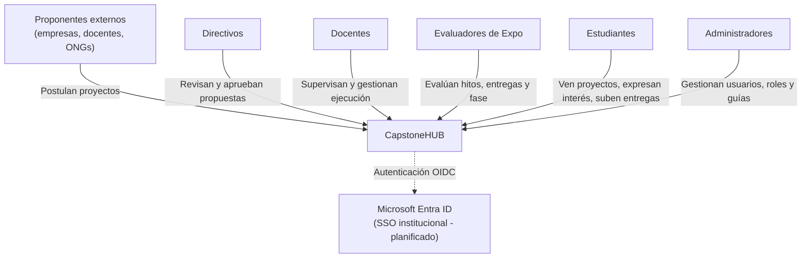
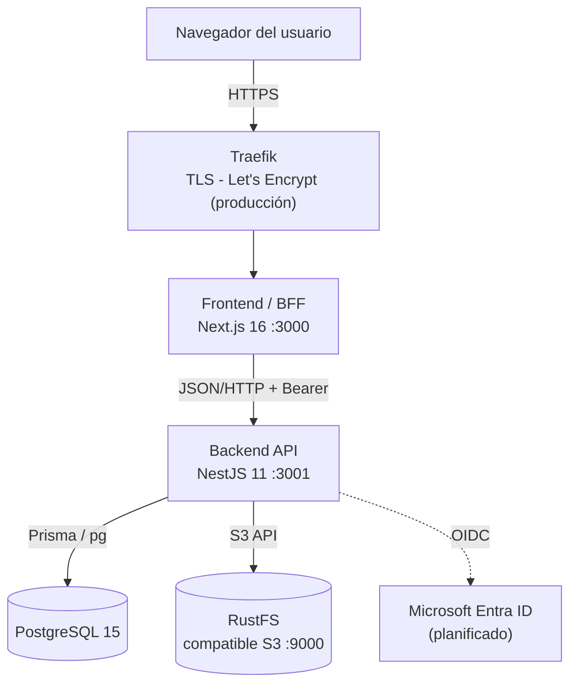
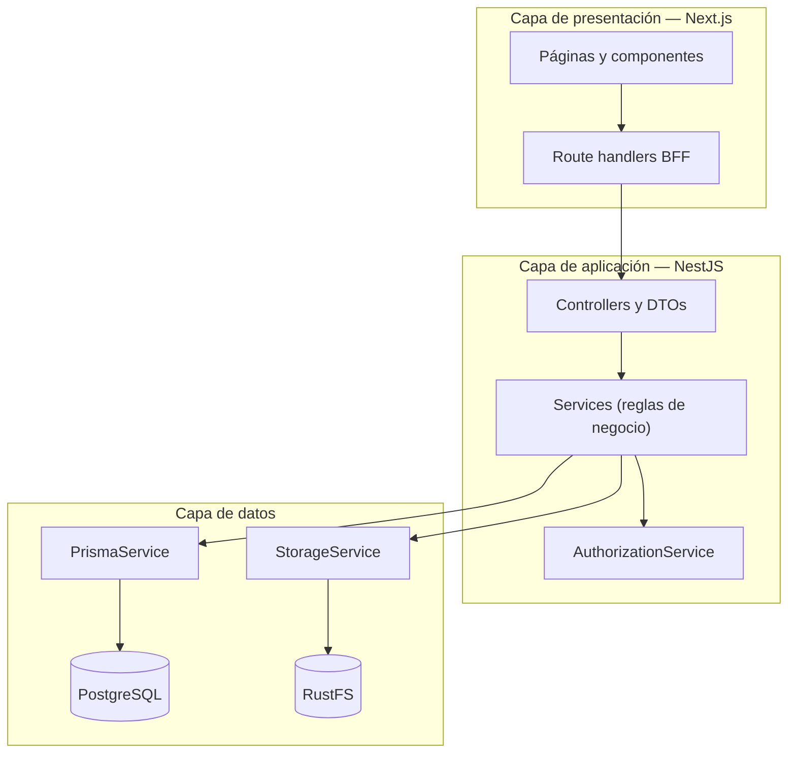
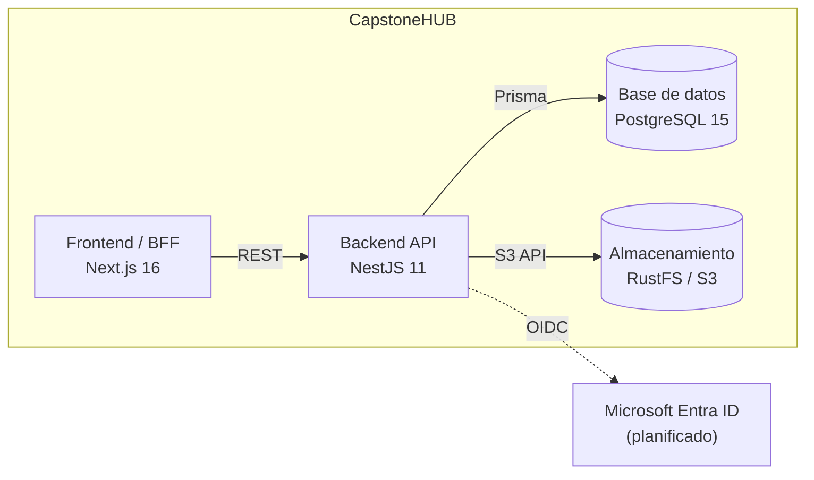
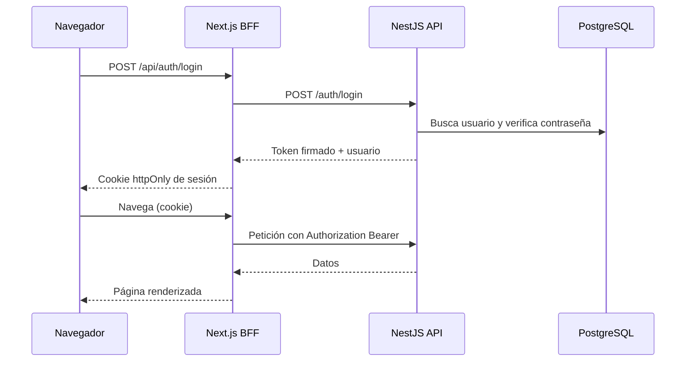
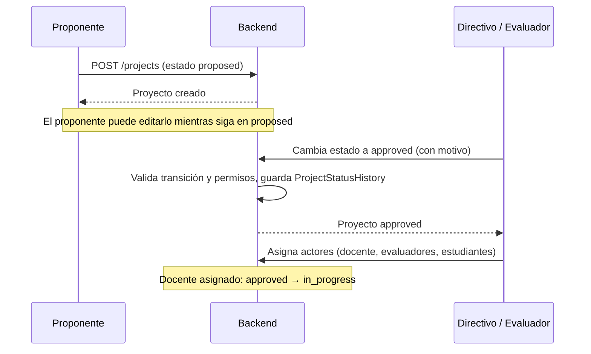
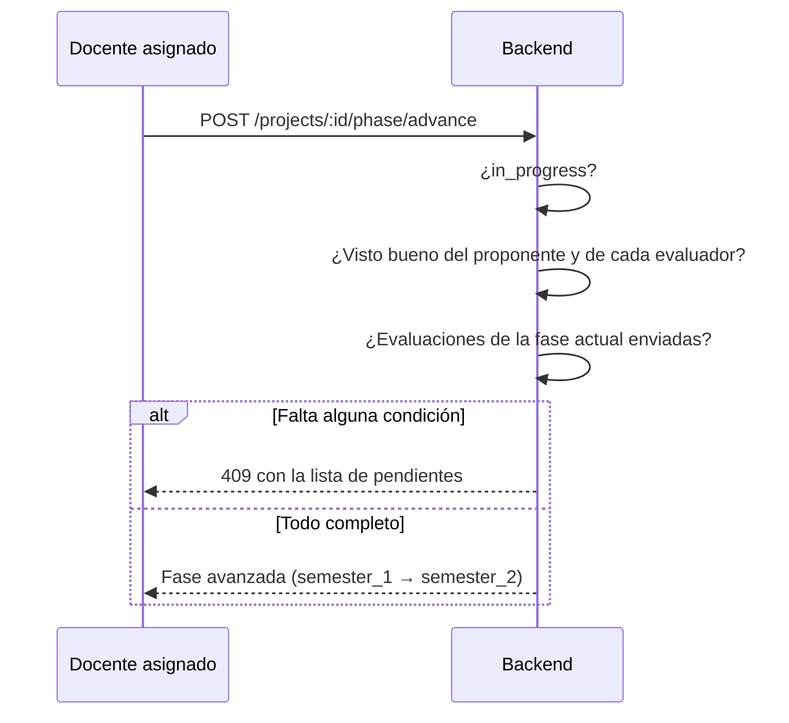
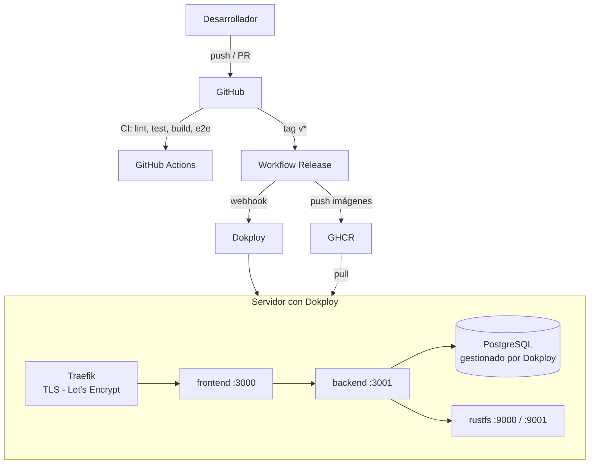

# Documentación de Arquitectura CapstoneHUB - arc42

> **Estado del documento:** actualizado según el estado actual del repositorio.
> En las tablas donde aplica, la columna **Estado** distingue lo **Implementado** de lo **Planificado** (aún sin código).

# Introducción y Metas {#section-introduction-and-goals}

## Vista de Requerimientos {#_vista_de_requerimientos}

CapstoneHUB es un sistema web de gestión integral para proyectos Capstone que facilita la postulación, evaluación, seguimiento y cierre de proyectos de titulación. El sistema permite a empresas, docentes y organizaciones sociales proponer proyectos, mientras que estudiantes y profesores pueden gestionar el ciclo completo de desarrollo.

### Requerimientos Funcionales Principales

| # | Requerimiento | Detalle | Estado |
|---|---------------|---------|--------|
| 1 | **Gestión de postulaciones** | Postulación de proyectos de ingeniería y consultoría con formato flexible (origen: entidad externa, investigación, necesidad interna o impacto social). Flujo de revisión por directivos y evaluadores. | Implementado |
| 2 | **Banco de proyectos** | Listado y detalle de proyectos, estados, galería de proyectos finalizados no privados, vista previa de proyectos aprobados para estudiantes e interés de estudiantes en proyectos. | Implementado |
| 3 | **Asignación de actores** | Asignación de docentes, evaluadores y estudiantes a cada proyecto (una persona solo tiene un rol por proyecto). | Implementado |
| 4 | **Hitos y entregas** | Evaluación informativa de hitos por programa, entregas (reportes) con contenido de tipo texto, enlace, imagen, video o archivo, y revisión (aceptar/rechazar). | Implementado |
| 5 | **Anexos y guías** | Anexos por proyecto y catálogo de formatos, plantillas y guías descargables. | Implementado |
| 6 | **Observaciones e historial** | Observaciones del proyecto, historial de estados e historial de cambios. | Implementado |
| 7 | **Evaluación** | Rúbricas por área, asignación de rúbrica por proyecto y fase, evaluación semestral con notas ponderadas, visto bueno de fase y bloqueo de avance/cierre. | Implementado |
| 8 | **Estadísticas** | KPIs por rol y panorama por semestre para admin y directivos. | Implementado |
| 9 | **Usuarios y roles** | Registro de proponentes, login local, 6 roles globales, roles de proyecto, administración de usuarios. | Implementado |
| 10 | **Single Sign-On (SSO)** | Inicio de sesión con cuenta institucional Microsoft (Entra ID, OIDC) en modo híbrido con el login local. Ya existe la base (campos de identidad externa y sesión por cookie); falta el flujo OIDC. | Planificado |
| 11 | **Automatización administrativa** | Generación de cartas de derecho y documentación oficial automatizada. | Planificado |
| 12 | **Notificaciones** | Correos y recordatorios automáticos de fechas límite. | Planificado |

## Metas de Calidad {#_metas_de_calidad}

| Prioridad | Atributo de Calidad | Escenario |
|-----------|---------------------|-----------|
| 1 | **Usabilidad** | El sistema debe ser intuitivo, con manual de usuario completo. Usuarios nuevos deben poder postular proyectos en menos de 15 minutos (formulario guiado por pasos). |
| 2 | **Mantenibilidad** | Arquitectura modular con NestJS y NextJS que permita actualizaciones independientes de frontend y backend. Pruebas automatizadas y CI en cada cambio. |
| 3 | **Portabilidad** | Todo el sistema debe ser desplegable mediante Docker en cualquier infraestructura. |
| 4 | **Seguridad** | Autenticación robusta, control de acceso basado en roles (RBAC) con permisos por asignación al proyecto y, a futuro, SSO institucional. |
| 5 | **Escalabilidad** | El sistema debe soportar múltiples postulaciones simultáneas y gestión de +100 proyectos concurrentes. |
| 6 | **Disponibilidad** | Sistema disponible 99% del tiempo durante períodos de postulación y entrega. |

## Partes interesadas (Stakeholders) {#_partes_interesadas_stakeholders}

| Rol/Nombre | Contacto | Expectativas |
|------------|----------|--------------|
| **Profesores Coordinadores** | Profesora coordinadora del proyecto | Sistema que simplifique la gestión administrativa de proyectos Capstone, con trazabilidad completa del proceso. |
| **Profesor Técnico** | Profesor de especificaciones técnicas | Infraestructura moderna, escalable y fácil de mantener usando tecnologías específicas (NestJS, NextJS, PostgreSQL, Docker). |
| **Directivos** | Profesores coordinadores | Interfaz clara para revisar y aprobar postulaciones de proyectos según criterios establecidos. |
| **Evaluadores de Expo** | Profesores jurados | Registro y consulta de la evaluación de las presentaciones finales de los proyectos. |
| **Estudiantes** | Alumnos de proyecto Capstone | Plataforma simple para visualizar proyectos disponibles, subir entregas y hacer seguimiento de su progreso. |
| **Empresas Postulantes** | Organizaciones externas | Proceso de postulación flexible y seguimiento del estado de sus propuestas. |
| **Docentes Postulantes** | Profesores con proyectos de investigación | Facilidad para proponer proyectos académicos y dar seguimiento. |
| **Organizaciones Sociales** | ONGs o proyectos comunitarios | Acceso simplificado para postular proyectos de impacto social. |
| **Administradores del Sistema** | IT de la institución | Sistema fácil de desplegar, mantener y monitorear. |
| **TI corporativa (UTB)** | Equipo que administra la identidad institucional | Registrar la aplicación en Entra ID y definir dominios y roles permitidos para el SSO. |

# Restricciones de la Arquitectura {#section-architecture-constraints}

## Restricciones Técnicas

| Restricción | Descripción |
|-------------|-------------|
| **Backend Framework** | Obligatorio usar **NestJS** (Node.js framework) |
| **Frontend Framework** | Obligatorio usar **NextJS** (React framework) |
| **Base de Datos** | Obligatorio usar **PostgreSQL** |
| **Containerización** | El sistema completo debe ser desplegable con **Docker** |
| **Tipo de Aplicación** | Aplicación **web** |
| **Identidad corporativa** | El SSO debe usar **OpenID Connect** contra Microsoft Entra ID (no SAML), y la app se registra con TI corporativa. |

## Restricciones Organizacionales

| Restricción | Descripción |
|-------------|-------------|
| **Equipo de Desarrollo** | Equipo estudiantil con supervisión de profesores |
| **Timeline MVP** | Definir y desarrollar MVP antes de la siguiente reunión de equipo |
| **Reunión de Validación** | Presentación con profesores responsables programadas |
| **Dependencia institucional** | El SSO depende de que la universidad entregue el registro de la aplicación. |

## Restricciones de Convenciones

| Restricción | Descripción |
|-------------|-------------|
| **Manual de Usuario** | Obligatorio proporcionar manual de usuario completo |
| **Formato de Postulación** | Debe ser más flexible que el formato actual manual |
| **Idioma** | Interfaz y documentación en español |
| **Identidad visual** | La interfaz sigue el sistema de diseño UTB (`docs/frontend_design_system.md`) |

# Alcance y Contexto del Sistema {#section-context-and-scope}

## Contexto de Negocio {#_contexto_de_negocio}

### Interfases de Negocio

| Interfaz | Actor | Descripción | Estado |
|----------|-------|-------------|--------|
| **Postulación de Proyectos** | Empresas, Docentes, ONGs | Formulario flexible por pasos para proponer proyectos | Implementado |
| **Evaluación de Propuestas** | Directivos, evaluadores asignados | Revisión y aprobación/rechazo de postulaciones | Implementado |
| **Asignación de Proyectos** | Admin, directivos, docentes | Asignación de actores y selección entre estudiantes interesados | Implementado |
| **Gestión de Entregas** | Estudiantes | Hitos, reportes y archivos por proyecto | Implementado |
| **Seguimiento de Proyectos** | Todos los roles según permisos | Estados, fases, observaciones, historial y estadísticas | Implementado |
| **Evaluación semestral** | Evaluadores, directivos | Rúbricas y notas ponderadas por fase | Implementado |
| **Generación de Documentos** | Sistema | Cartas y documentos oficiales | Planificado |

## Contexto Técnico {#_contexto_t_cnico}

### Interfases Técnicas

| Interfaz | Tecnología | Descripción | Estado |
|----------|------------|-------------|--------|
| **Navegador ↔ Frontend** | HTTPS | Cookie de sesión `httpOnly` gestionada por el BFF | Implementado |
| **Frontend ↔ Backend** | REST (JSON/HTTP) | El BFF reenvía las peticiones con el token Bearer a `BACKEND_URL` | Implementado |
| **Backend ↔ Database** | Prisma 7 con adaptador `pg` | ORM con migraciones versionadas (`prisma migrate`) | Implementado |
| **Backend ↔ File Storage** | API S3 (AWS SDK) hacia RustFS | Anexos, archivos de entregas y guías | Implementado |
| **Backend ↔ SSO** | OpenID Connect (Entra ID v1) | Cliente confidencial en el backend, callback por POST (`form_post`) | Planificado |
| **Container Orchestration** | Docker Compose | `compose.yml` (local) y `compose.dokploy.yml` (producción) | Implementado |
| **Documentación de la API** | Swagger en `/api` | Habilitado en local, deshabilitado en producción | Implementado |

### Mapeo de Entrada/Salida a Canales

| Entrada/Salida | Canal | Formato |
|----------------|-------|---------|
| Postulación de proyecto | HTTPS (Frontend → Backend) | JSON |
| Carga de anexos, entregas y guías | HTTPS (Frontend → Backend) | multipart/form-data |
| Consultas de datos | HTTPS (Frontend ↔ Backend) | JSON |
| Descarga de archivos | HTTPS (Backend → Frontend) | Stream desde RustFS |
| Notificaciones | Email *(planificado)* | HTML/Texto plano |
| Generación de PDFs | Backend → File Storage *(planificado)* | PDF |
| Autenticación SSO | HTTPS (Backend ↔ Entra ID) *(planificado)* | OIDC (`code`, `state`, `nonce`) |

# Estrategia de solución {#section-solution-strategy}

## Decisiones Tecnológicas

### Stack Principal

1. **Frontend: Next.js 16 (App Router)**
   - React 19, TypeScript, Tailwind v4 y shadcn/ui con el sistema de diseño UTB
   - Route handlers (`app/api`) que actúan como **BFF**: proxy hacia el backend y dueño de la cookie de sesión
   - Pruebas end-to-end con Playwright
2. **Backend: NestJS 11**
   - Arquitectura modular con inyección de dependencias y TypeScript
   - Prisma 7 como ORM; documentación con Swagger
3. **Base de Datos: PostgreSQL 15**
   - Transacciones ACID (por ejemplo, cada cambio de estado se guarda junto con su historial)
   - Migraciones versionadas
4. **Almacenamiento de archivos: RustFS (compatible con S3)**
   - Detrás de una abstracción (`StorageService`) que permite cambiar de proveedor
5. **Containerización y entrega: Docker, GitHub Actions, GHCR y Dokploy**

## Enfoque Arquitectónico

### Patrón: Monolito modular (backend) + BFF (frontend)

### Módulos Principales del Backend

| Módulo | Responsabilidad |
|--------|-----------------|
| **Auth** | Registro, login, usuarios, roles; guards y `AuthorizationService` |
| **Projects** | CRUD de proyectos, actores, estados, fases, intereses, historial |
| **Milestone assessments** | Evaluación de hitos por programa y proyecto |
| **Reports** | Entregas, su contenido y revisión |
| **Observations** | Observaciones del proyecto |
| **Attachments** | Anexos del proyecto |
| **Rubrics** | Plantillas de rúbricas y asignación por proyecto/fase |
| **Evaluations** | Evaluación semestral, notas ponderadas, bloqueo de fase/cierre |
| **Guides** | Catálogo de formatos, plantillas y guías |
| **Stats** | KPIs y panorama por semestre |
| **Health** | `GET /health` |
| **Documents** *(planificado)* | Generación de PDFs oficiales |
| **Notifications** *(planificado)* | Emails y alertas de fechas límite |

## Enfoque para Alcanzar Metas de Calidad

| Meta de Calidad | Estrategia de Solución |
|-----------------|------------------------|
| **Usabilidad** | Formulario de propuesta por pasos, sistema de diseño consistente, feedback visual inmediato, manual de usuario |
| **Mantenibilidad** | Módulos NestJS con responsabilidades claras, separación frontend/backend, TypeScript en todo el stack, Jest + Supertest + Playwright, lint y CI en cada PR, Dependabot |
| **Portabilidad** | Imágenes Docker, configuración solo por variables de entorno (sin modos en el código), `compose.yml` local y `compose.dokploy.yml` productivo |
| **Seguridad** | Contraseñas con hash, token firmado en cookie `httpOnly` (el navegador no guarda el token), RBAC más asignación por proyecto, Swagger y seeder deshabilitados en producción, RustFS inaccesible desde fuera, HTTPS vía Traefik |
| **Escalabilidad** | Backend sin estado (el token viaja en cada petición), archivos fuera de la base de datos, consultas con Prisma sobre PostgreSQL |
| **Disponibilidad** | Endpoint `/health`, el backend arranca aunque la base de datos esté caída y responde `503` en las rutas que la necesitan |

## Decisiones Organizacionales

### Definición de MVP

El detalle está en `docs/MVP.md`. El MVP debía permitir postular proyectos, revisarlos, asignar actores y dar seguimiento básico con despliegue en contenedores. **Ese alcance está superado:** el sistema ya incluye hitos, entregas, anexos, guías, rúbricas, evaluaciones y estadísticas.

**Pendiente (fuera de lo implementado hoy):**
- SSO con Microsoft Entra ID
- Generación automática de documentos y cartas
- Notificaciones por correo y recordatorios

---

# Vista de Bloques {#section-building-block-view}

## Nivel 1: Sistema General de Caja Blanca {#_sistema_general_de_caja_blanca}

### Motivación

El sistema se divide en cuatro contenedores desacoplados que se comunican mediante interfaces bien definidas, permitiendo desarrollo, testeo y despliegue independiente.

### Bloques de construcción contenidos

| Componente | Responsabilidad |
|------------|-----------------|
| **Frontend / BFF** | Interfaz de usuario, renderizado, sesión por cookie y proxy hacia la API |
| **Backend API** | Lógica de negocio, validaciones, autenticación, autorización y orquestación de datos |
| **Base de datos** | Persistencia de datos, integridad referencial, historial |
| **Almacenamiento de objetos** | Anexos, archivos de entregas y documentos de guías |
| **Entra ID** *(planificado)* | Autenticación de usuarios con cuenta institucional |

### Interfases importantes

- **Frontend ↔ Backend**: REST con token Bearer reenviado por el BFF
- **Backend ↔ Database**: Prisma sobre PostgreSQL
- **Backend ↔ Storage**: API S3
- **Backend ↔ SSO**: OIDC con correo institucional *(planificado)*

## Nivel 2: Backend API (caja blanca)

| Componente | Responsabilidad |
|------------|-----------------|
| `LoggerMiddleware` | Asigna `request-id` y registra una línea JSON por petición |
| `AuthGuard` / `AdminGuard` | Validan el token y exigen el rol `admin` donde corresponde |
| `AuthorizationService` | Centraliza permisos por rol global y por rol dentro del proyecto |
| Módulos de dominio | Auth, Projects, Milestone assessments, Reports, Observations, Attachments, Rubrics, Evaluations, Guides, Stats, Health |
| `PrismaService` | Acceso a datos |
| `StorageService` / `S3StorageService` | Abstracción de archivos y limpieza de objetos huérfanos (`npm run storage:gc`) |
| `DatabaseExceptionFilter` | Traduce errores de conexión a PostgreSQL en `503` |

El diagrama de componentes está en `C4_CapstoneHUB_drawio.md` (nivel 3).

## Nivel 2: Frontend / BFF (caja blanca)

| Componente | Responsabilidad |
|------------|-----------------|
| Páginas (`app/`) | `/`, `/home`, `/login`, `/register`, `/projects`, `/submit`, `/profile`, `/guides`, `/admin/*` |
| Componentes UI | Shell, sidebar, navbar y formularios (shadcn/ui, sistema UTB) |
| Capa de servicios (`app/services`) | Comunicación con la API por dominio |
| Route handlers BFF (`app/api`) | Proxy con streaming y multipart; login, registro, logout y renovación de la sesión |

## Nivel 3: Modelo de datos (resumen)

| Grupo | Entidades |
|-------|-----------|
| Usuarios | `User`, `UserRoleAssignment` |
| Proyecto | `Project`, `ProjectProgramRequirement`, `ProjectSchool`, `ProjectDeliverable`, `ProjectNaturalProposer` |
| Participación | `ProjectActorAssignment`, `ProjectInterest` |
| Seguimiento | `ProjectObservation`, `ProjectStatusHistory`, `ProjectChangeHistory`, `ProjectPhaseApproval` |
| Hitos y entregas | `ProjectMilestoneAssessment`, `ProjectReport`, `ProjectReportContent`, `ProjectAttachment` |
| Evaluación | `RubricTemplate`, `RubricCriterion`, `ProjectRubricAssignment`, `ProjectEvaluation`, `ProjectEvaluationCriterion` |
| Catálogo | `GuideDocument` |

Detalle en `docs/database_arch.md` y `docs/Estructura_DB.md`.

---

# Vista de Ejecución {#section-runtime-view}

## Escenario 1: Inicio de sesión local

El BFF renueva la sesión de forma deslizante: reemite el token cuando supera cierta antigüedad.

## Escenario 2: Postulación y aprobación de un proyecto

Ciclo de vida: `proposed → approved → in_progress → closed`, con `paused`, `cancelled` y `rejected`. `under_review` es un estado heredado que solo puede salir hacia `approved` o `rejected`.

## Escenario 3: Avance de fase (semestre)

El bloqueo es estricto y aplica también al `admin`.

## Escenario 4: Subida de un archivo en una entrega

El estudiante envía un `multipart/form-data` al BFF, que lo reenvía en streaming al backend. El backend valida permisos y tamaño máximo, guarda el objeto en RustFS mediante `StorageService` y registra los metadatos en PostgreSQL. Los objetos que queden sin registro se eliminan con `npm run storage:gc`.

---

# Vista de Despliegue {#section-deployment-view}

| Aspecto | Local | Producción |
|---------|-------|------------|
| Ejecución | `npm run start:dev` / `next dev` o `compose.yml` | Imágenes compiladas vía `compose.dokploy.yml` |
| Base de datos | Contenedor en `localhost:5432` | Contenedor `db:5432` o gestionada por Dokploy |
| Migraciones | `prisma migrate dev` | `prisma migrate deploy` al arrancar el backend |
| Seed | `npm run seed` | Bloqueado si `NODE_ENV=production` |
| Almacenamiento | RustFS en `http://localhost:9000` | RustFS interno, solo accesible desde el backend |
| `BACKEND_URL` | `http://localhost:3001` | `http://backend:3001` |
| Swagger (`/api`) | Habilitado | Deshabilitado (`SWAGGER_ENABLED=false`) |
| TLS y dominio | No | Traefik + Let's Encrypt |

**Entrega continua**
- **CI** (PR y push a `main`): lint, tests y build del backend; lint y build del frontend; pruebas end-to-end (Supertest + Playwright) contra una base de datos con migraciones aplicadas.
- **Release** (tag `vX.Y.Z`): construye y publica `capstonehub-backend` y `capstonehub-frontend` en GHCR y dispara el webhook de Dokploy.
- **Dependabot:** PRs semanales para GitHub Actions, dependencias npm e imágenes base.

Detalle en `docs/deployment.md`.

---

# Conceptos Transversales {#section-concepts}

## Autenticación y sesión
Login local con contraseña almacenada como hash. El backend emite un token firmado con `AUTH_SECRET` y con vida configurable (`AUTH_TOKEN_TTL_SECONDS`). El token vive en una cookie `httpOnly` del BFF, por lo que el navegador no puede leerlo. La renovación es deslizante. El SSO con Entra ID se agregará en modo **híbrido** (convive con el login local), con aprovisionamiento automático en el primer ingreso y roles tomados de los *App Roles* de Entra.

## Autorización (RBAC + asignación por proyecto)
- **Roles globales (`UserRole`)**: `admin`, `directivo`, `evaluator`, `teacher`, `proposer`, `student`.
- **Roles de proyecto (`ActorRole`)**: `teacher`, `evaluator`, `student`.
- El `admin` siempre pasa. El `directivo` ve todos los proyectos y resuelve la fase de propuesta. `evaluator`, `teacher` y `student` solo actúan en los proyectos donde están asignados. El `proposer` solo edita sus propuestas mientras estén en `proposed`.
- Una persona solo puede tener un rol por proyecto, y el rol de proyecto debe estar permitido por su rol global.
- La lógica está centralizada en `AuthorizationService`.

## Visibilidad de proyectos
Sin sesión solo se ven los proyectos finalizados y no privados. Con sesión se suman los no privados en `approved`, `in_progress` o `paused`. Los estudiantes ven los privados aprobados con información limitada (vista previa).

## Trazabilidad
Cada cambio de estado se guarda en `ProjectStatusHistory` dentro de una transacción y exige un motivo (salvo para `admin`). Los cambios de datos se registran en `ProjectChangeHistory`.

## Evaluación
Cada proyecto tiene una rúbrica por fase. La nota total ponderada se calcula en el backend y se guarda con un *snapshot* de los criterios. Las plantillas con evaluaciones no se pueden editar y la asignación se bloquea al existir una evaluación.

## Manejo de errores

| Estado | Cuándo |
|--------|--------|
| `400` | DTO inválido, transición inválida o motivo faltante |
| `401` | Token ausente, malformado o expirado |
| `403` | Autenticado pero sin rol o asignación en el proyecto |
| `404` | Recurso no encontrado |
| `409` | Duplicado o condiciones pendientes (avance de fase, cierre) |
| `500` | Configuración requerida faltante |
| `503` | Base de datos no disponible |

## Logging y observabilidad
`LoggerMiddleware` asigna un `request-id` a cada petición y escribe una línea JSON por petición. `GET /health` permite sondas de disponibilidad.

## Configuración y secretos
Solo variables de entorno (`DATABASE_URL`, `AUTH_SECRET`, tiempos de token, credenciales del admin inicial, límites de tamaño de archivos, `BACKEND_URL`, `SWAGGER_ENABLED`). No hay modos de ejecución en el código. Las variables del SSO (`AZURE_*`) están documentadas pero todavía no se leen.

## Persistencia y archivos
PostgreSQL para datos y RustFS para binarios, detrás de `StorageService`. Límites de tamaño configurables para anexos, entregas (100 MB por defecto) y guías (25 MB por defecto). La limpieza de objetos huérfanos se ejecuta con un comando de mantenimiento.

## Pruebas
- **Unitarias:** Jest, junto al código (`*.spec.ts`).
- **End-to-end del backend:** Supertest (`test/*.e2e-spec.ts`: auth, evaluaciones, guías, evaluación de hitos, observaciones).
- **End-to-end del frontend:** Playwright.
- Todo se ejecuta en CI.

## Interfaz de usuario
Sistema de diseño UTB con shadcn/ui y Tailwind v4. Interfaz en español.

---

# Decisiones de Diseño {#section-design-decisions}

| N | Decisión | Justificación | Consecuencias |
|----|----------|---------------|---------------|
| **001** | Usar NextJS para frontend | Requerimiento del profesor. SSR mejora SEO y performance. | Curva de aprendizaje moderada, pero buen soporte de comunidad. |
| **002** | Usar NestJS para backend | Requerimiento del profesor. Arquitectura modular escalable. | Estructura de proyecto más compleja que Express simple. |
| **003** | PostgreSQL como base de datos | Requerimiento del profesor. Relacional, robusto, open-source. | Necesidad de modelar schema cuidadosamente. |
| **004** | Implementar SSO con Entra ID (OIDC), en modo híbrido | Mayor seguridad, mejor UX, integración con identidad institucional. Se mantiene el login local. | Dependencia de que TI entregue el registro de la app. Mientras tanto solo existe el login local. |
| **005** | Arquitectura monolítica modular | Simplicidad para el MVP, fácil de desplegar con Docker. | Puede requerir refactor a microservicios en el futuro. |
| **006** | TypeScript en todo el stack | Type safety, mejor mantenibilidad, menos errores en runtime. | Overhead inicial de configuración y tipado. |
| **007** | Prisma como ORM | Tipado fuerte, migraciones versionadas, buena integración con TypeScript. | Dependencia del cliente generado; hay que ejecutar `prisma generate` en CI y en el build. |
| **008** | RustFS (compatible S3) para archivos, detrás de `StorageService` | Mantiene los binarios fuera de la base de datos y permite cambiar de proveedor. | Un contenedor más que operar; la imagen usa la etiqueta `latest`. |
| **009** | Next.js como BFF con sesión en cookie `httpOnly` | Evita CORS, oculta la URL del backend y el navegador nunca guarda el token. | Todo el tráfico pasa por el BFF, incluidas las subidas (streaming). |
| **010** | Roles globales más rol por proyecto, con permisos centralizados | Permite que docentes y evaluadores actúen solo en sus proyectos. | Los permisos viven en `AuthorizationService` y la matriz debe mantenerse al día. |
| **011** | Estado y fase del proyecto independientes | Un proyecto `in_progress` puede avanzar de semestre sin cambiar de estado. | Dos máquinas de estado que validar. |
| **012** | Avance de fase y cierre bloqueados por evaluaciones y vistos buenos, sin excepción para `admin` | Garantiza que se cumpla el proceso académico. | El admin no puede saltarse el proceso; hay que resolver los pendientes. |
| **013** | Despliegue con GitHub Actions, GHCR y Dokploy (Traefik + Let's Encrypt) | Entrega reproducible por tags y TLS automático. | Depende de un servidor con Dokploy y de secretos del registry. |

---

# Requisitos de Calidad {#section-quality-scenarios}

| Atributo | Escenario | Cómo se atiende | Estado |
|----------|-----------|-----------------|--------|
| **Usabilidad** | Un usuario nuevo postula un proyecto en menos de 15 minutos | Formulario por pasos y diseño consistente | Por medir con usuarios |
| **Mantenibilidad** | Un cambio en el backend no obliga a modificar el frontend | Contrato REST, módulos separados, CI | Cubierto |
| **Portabilidad** | Se despliega todo el sistema en un servidor nuevo | Imágenes Docker y variables de entorno | Cubierto |
| **Seguridad** | Un estudiante intenta editar un proyecto en el que no está asignado | `AuthorizationService` responde `403` | Cubierto |
| **Seguridad** | Se roba el contenido del navegador | El token está en cookie `httpOnly` | Cubierto |
| **Disponibilidad** | La base de datos cae durante un período de entrega | El backend sigue arrancado y responde `503` en las rutas afectadas | Parcial; la meta de 99% no se ha medido |
| **Escalabilidad** | 100+ proyectos concurrentes | Backend sin estado y archivos fuera de la BD | Sin pruebas de carga |

---

# Riesgos y deuda técnica {#section-technical-risks}

| Riesgo | Probabilidad | Impacto | Mitigación |
|--------|--------------|---------|------------|
| **Integración SSO no disponible a tiempo** | Media | Alto | Ya existe el login local como respaldo y la base de datos preparada (`authProvider`, `entraObjectId`). Falta el registro de la app por TI y el flujo OIDC. |
| **Alcance no claro** | Media | Medio | `MVP.md` define el alcance. Validar lo pendiente con los profesores. |
| **Generación de documentos oficiales compleja** | Media | Medio | Queda fuera de lo implementado; priorizar funcionalidad principal. |
| **Notificaciones por correo ausentes** | Media | Medio | Recordatorios manuales hasta implementar el módulo. |
| **Imagen de RustFS con `latest`** | Media | Medio | Fijar una versión concreta en `compose.dokploy.yml`. |
| **Infraestructura de producción dependiente de Dokploy** | Baja | Medio | Documentada en `docs/deployment.md`; el despliegue con Docker Compose funciona en cualquier servidor. |
| **Meta de disponibilidad y escalabilidad sin medir** | Media | Medio | Agregar monitoreo y pruebas de carga antes de la presentación final. |

**Deuda técnica**
- Estado heredado `under_review` conservado solo por compatibilidad.
- Variables `AZURE_*` documentadas pero sin código que las use.
- Módulos de documentos y notificaciones sin implementar.

---

# Glosario {#section-glossary}

| Término | Definición |
|---------|------------|
| **Capstone** | Proyecto de titulación que culmina la carrera de ingeniería |
| **MVP** | Minimum Viable Product - Producto mínimo viable para validación |
| **SSO** | Single Sign-On - Sistema de autenticación única |
| **OIDC** | OpenID Connect - Protocolo de identidad sobre OAuth 2.0 |
| **Entra ID** | Servicio de identidad de Microsoft (antes Azure AD) |
| **BFF** | Backend for Frontend - Capa del frontend que hace de proxy hacia la API |
| **Hito** | Requisito evaluable del proyecto según su programa académico |
| **Evaluación de hitos** | Registro informativo Sí/No/N/A y observaciones por requisito; no bloquea el proyecto |
| **Fase** | Semestre del proyecto (`semester_1`, `semester_2`), independiente del estado |
| **Visto bueno de fase** | Aprobación del proponente y de cada evaluador para avanzar de fase |
| **Rúbrica** | Plantilla de criterios ponderados para evaluar un proyecto en una fase |
| **Directivo** | Rol global que revisa y aprueba postulaciones y supervisa los proyectos |
| **Evaluador de Expo** | Rol que evalúa las presentaciones en los proyectos donde se le asigna |
| **Proponente** | Persona o entidad externa que propone un proyecto |
| **Actor de proyecto** | Persona asignada a un proyecto con rol `teacher`, `evaluator` o `student` |
| **Postulación** | Propuesta de proyecto presentada por empresas, docentes u ONGs |
| **Asignación** | Proceso de vincular actores a un proyecto aprobado |
| **RBAC** | Role-Based Access Control - Control de acceso basado en roles |
| **ORM** | Object-Relational Mapping - Mapeo objeto-relacional |
| **GHCR** | GitHub Container Registry - Registro de imágenes Docker |
| **Dokploy** | Plataforma de despliegue que levanta los contenedores en el servidor |
| **RustFS** | Almacenamiento de objetos compatible con la API de S3 |
| **Docker Compose** | Herramienta para definir y ejecutar aplicaciones Docker multi-contenedor |
